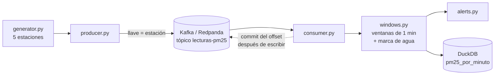

# Proyecto 8 · Streaming en tiempo real con Kafka

Parte de mi [ruta de ingeniería de datos](https://github.com/josemelguizo/ruta-datos).

 

> **Esto es un reto, no una solución.** El simulador, el productor, el consumidor de Kafka y las pruebas están listos; la lógica de ventanas, alertas y escritura la escribes tú.

## El reto

En el Valle de Aburrá los episodios de mala calidad del aire obligan a tomar decisiones rápidas (pico y placa ambiental, alertas a colegios). Cinco estaciones envían lecturas de PM2.5 cada pocos segundos. Hay que calcular el **promedio por minuto de cada estación en tiempo real** y alertar apenas se cruce un umbral.

El problema: en streaming los eventos llegan **desordenados**, algunos **muy tarde** y otros **repetidos**. Un promedio ingenuo da resultados equivocados. Vas a construir la lógica que lo resuelve: ventanas por tiempo de evento y marcas de agua, los mismos conceptos que usan Spark Structured Streaming y Flink.

## Qué vas a practicar

- Productores, consumidores, tópicos, particiones y grupos de consumo en Kafka
- Tiempo de evento frente a tiempo de llegada
- Ventanas *tumbling* y **marcas de agua** (*watermarks*)
- Datos tardíos y duplicados
- Garantías de entrega: *at-least-once* + escritura idempotente = efecto *exactly-once*

## Arquitectura



## Preparación

```bash
python -m venv .venv
.venv\Scripts\activate          # Windows  (source .venv/bin/activate en macOS/Linux)
pip install -e ".[dev]"
pytest                          # todo en rojo
```

Antes de programar, dibuja en papel una línea de tiempo con estos eventos (segundo en que ocurrieron, en orden de llegada): `10, 65, 50, 85`, con ventanas de 60 s y tolerancia de 20 s. ¿En qué momento se puede cerrar la ventana 0–60? ¿El evento 50 entra? La prueba `test_evento_desordenado_dentro_de_la_tolerancia_cuenta` tiene la respuesta.

## Fases

| Fase | Archivo | Tests |
|---|---|---|
| 1. Ventanas | `windows.py`: `window_start`, `watermark` | `pytest -k "inicio or no_emite"` |
| 2. Emitir y tardíos | `windows.py`: `add`, `flush` | `pytest -k "ventana or emite or evento or duplicados or flush or simulador_no"` |
| 3. Alertas | `alerts.py` | `pytest -k "clasificacion or detecta or episodio"` |
| 4. Sink idempotente | `sink.py` | `pytest -k sink` |
| 5. Con Kafka de verdad | (nada nuevo) | ver abajo |

**Fase 5.** Enciende Redpanda y abre dos terminales:

```bash
docker compose up -d
python -m streaming.consumer                    # terminal 1: queda escuchando
python -m streaming.producer --n 3000 --rate 50 # terminal 2: envía lecturas
```

Abre la consola en [localhost:8080](http://localhost:8080) y mira el tópico `lecturas-pm25`: sus particiones, los mensajes y el *lag* del grupo `agregador-pm25`.

Experimentos para el README:

1. Mata el consumidor con Ctrl+C a la mitad y vuelve a arrancarlo. ¿Retoma donde iba? ¿Se duplicaron ventanas en DuckDB?
2. Arranca **dos** consumidores a la vez. ¿Cómo se reparten las particiones? ¿Qué pasa con las ventanas de cada uno?
3. Sube `allowed_lateness_seconds` a 600 en `consumer.py`. ¿Qué ganas y qué pierdes?

> El Docker Compose se validó en sintaxis, pero no se probó encendido. Si algo no arranca, arreglarlo es parte del aprendizaje: anótalo en el README.

## Criterios de terminado

- [ ] `pytest` en verde en GitHub Actions
- [ ] El flujo completo funcionando con Redpanda, con una captura de la consola
- [ ] Los 3 experimentos de la fase 5 respondidos
- [ ] Explicación con tus palabras: ¿por qué hacer commit del offset **después** de escribir, y no antes?

## Para ir más allá

- Reescribe el consumidor con **Spark Structured Streaming** (`withWatermark` y `window`) y compara los resultados con los tuyos.
- Agrega ventanas deslizantes (*sliding*): promedio de los últimos 5 minutos, actualizado cada minuto.
- Manda los eventos tardíos a un tópico aparte (*dead letter queue*) en lugar de descartarlos.
- Agrega un esquema con Avro y el Schema Registry que trae Redpanda.

## Recursos

- [Kafka: conceptos básicos](https://kafka.apache.org/documentation/#introduction)
- [Cliente de Kafka para Python (confluent-kafka)](https://docs.confluent.io/kafka-clients/python/current/overview.html)
- [Watermarks en Spark Structured Streaming](https://spark.apache.org/docs/latest/structured-streaming-programming-guide.html#handling-late-data-and-watermarking)
